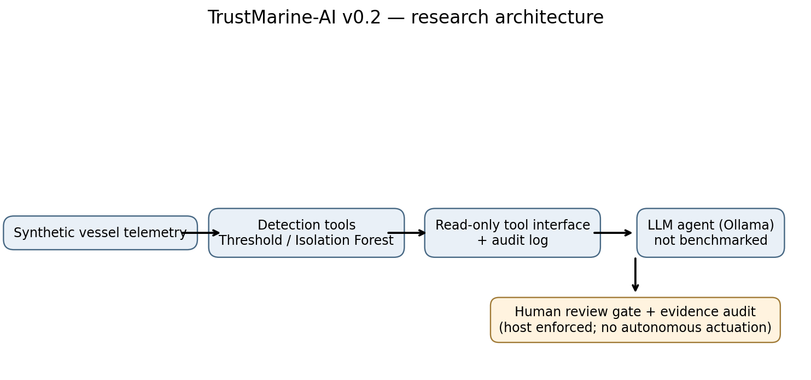
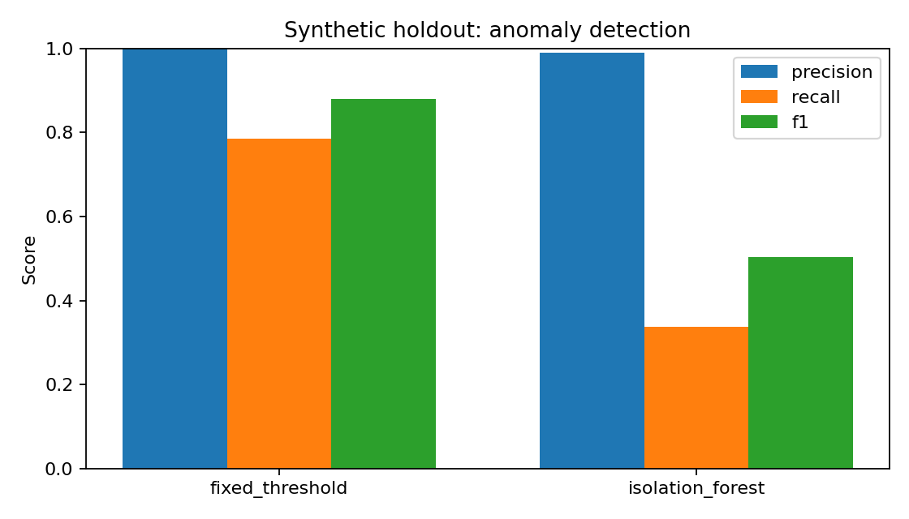
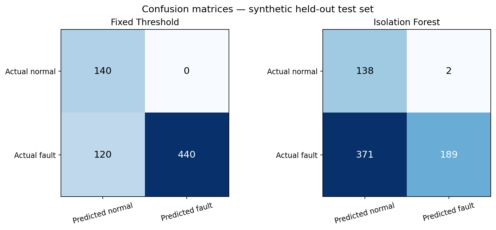

# TrustMarine-AI

**Trustworthy Agentic AI for Maritime Condition Monitoring and Predictive Maintenance**  
*Independent research & portfolio project | Research prototype v0.2*

> **Portfolio disclosure:** TrustMarine-AI is a self-initiated, independently developed research and portfolio project intended to demonstrate practical interests in trustworthy AI, tool-using language-model agents, anomaly detection, control engineering, and maritime systems. It is not an institutional project, a commercially deployed product, or a safety-certified shipboard system. All included evaluation data are synthetic.

## At a glance

| Area | Implementation |
|---|---|
| Application | Synthetic maritime machinery and electrical-system condition monitoring |
| Anomaly detection | Fixed-threshold baseline and Isolation Forest |
| Agentic AI | Local Ollama `/api/chat` integration with allowlisted, read-only tools |
| Safety and accountability | Independent human-review gate and machine-readable audit trail |
| Evidence | Reproducible baseline metrics, confusion matrices, and illustrative agent cases |
| Validation status | Six automated tests passed; **real local LLM inference not yet benchmarked** |

## System overview

The diagrams and plots below are committed to the repository under `assets/`, so they render directly on GitHub without running any scripts.



The research goal is to examine whether a tool-using AI assistant can support *traceable*, *bounded*, and *reviewable* diagnostic workflows. The architecture separates deterministic analysis and host-enforced safety checks from language-model-generated explanations.

## Experimental results — synthetic baseline

These results describe **binary anomaly detection only**. They do not measure the LLM's diagnostic accuracy or real-world maritime performance. Source: [`results/metrics.csv`](results/metrics.csv).

| Detector | Precision | Recall | F1 | TP | FP | FN | TN |
|---|---:|---:|---:|---:|---:|---:|---:|
| Fixed threshold | 1.000 | 0.786 | 0.880 | 440 | 0 | 120 | 140 |
| Isolation Forest | 0.990 | 0.338 | 0.503 | 189 | 2 | 371 | 138 |



### Confusion matrices



**Interpretation.** On this hand-specified synthetic dataset, fixed thresholds achieved higher recall and F1 than Isolation Forest. The detector's missed anomalies indicate the need to revisit feature engineering, temporal context, and training assumptions. These outcomes should **not** be generalized to operational vessels.

## What the LLM can do

The [`src/llm_agent.py`](src/llm_agent.py) module connects to an Ollama-hosted, tool-calling-capable language model. The host exposes four allowlisted, read-only tools:

- `inspect_sensors` — inspect synthetic sensor readings.
- `detect_anomaly` — request the anomaly detector output.
- `diagnostic_baseline` — retrieve deterministic diagnostic evidence.
- `get_maintenance_note` — retrieve an illustrative maintenance note.

The host records tool interactions in a JSON audit trail and applies a human-review rule independently of the model. **The software integration has been tested with simulated model responses, but an actual Ollama model run has not yet been performed in this environment.**

## Reproduce the results

Requires Python 3.10+.

```bash
python -m venv .venv
# Windows: .venv\\Scripts\\activate
# macOS/Linux: source .venv/bin/activate
python -m pip install -r requirements.txt
python run_experiment.py
python -m pytest -q
```

Generated files include `results/metrics.csv`, `results/comparison.png`, and `results/agent_cases.json`.

### Run a real local LLM

Install [Ollama](https://ollama.com/), then:

```bash
ollama pull qwen2.5:7b
# Run `ollama serve` if Ollama is not already running.
python run_llm.py --model qwen2.5:7b --fault bearing_wear
```

The local model download is not included in this repository. The model must support tool calling. The run saves `results/llm_run.json` for inspection.

## Evaluation status

| Evaluation item | Status |
|---|---|
| Synthetic anomaly detection metrics | Measured; CSV and figures included |
| Host-side LLM tool protocol | Tested using simulated model responses |
| Real-model tool-selection accuracy | **Not measured** |
| Evidence-grounding / hallucination rate | **Not measured** |
| Prompt-injection resistance | **Not measured** |
| Uncertainty calibration | **Not measured** |
| Real-vessel performance | **Not evaluated** |

## Research questions and next steps

1. How accurately can a local, open-weight agent choose diagnostic tools and cite their outputs?
2. When should a diagnostic agent abstain or request engineer review?
3. How do noisy sensors, unfamiliar faults, and manipulated maintenance notes affect evidence fidelity?
4. Does an explicit verification layer reduce unsupported maintenance recommendations?

Planned extensions include time-series baselines, calibration experiments, adversarial note tests, systematic LLM evaluation, and appropriately licensed operational datasets.

## Limitations and responsible use

This is a **portfolio and research demonstration**, not a validated maritime diagnostic product. Synthetic faults are simplified; the threshold baseline is not an industrial alarm system; anomaly scores are not calibrated probabilities; and diagnostic heuristics do not establish causation. Do not use this project for vessel navigation, safety decisions, maintenance authorization, or control of physical equipment.

## Repository structure

```text
TrustMarine-AI/
├── README.md
├── assets/
│   ├── architecture.png
│   ├── comparison.png
│   └── confusion_matrices.png
├── requirements.txt
├── run_experiment.py
├── run_llm.py
├── src/
│   ├── core.py
│   └── llm_agent.py
├── tests/
│   ├── test_core.py
│   └── test_llm_agent.py
└── results/
    ├── architecture.png
    ├── comparison.png
    ├── confusion_matrices.png
    ├── metrics.csv
    └── agent_cases.json
```

## Author and context

**Mehmet Ateş** — Electrical and Electronics Engineering; M.Sc. candidate in Control and Automation Engineering. Interests: maritime autonomous systems, machine learning, trustworthy AI, and control engineering.

**Project status:** Independent portfolio research prototype (v0.2).
